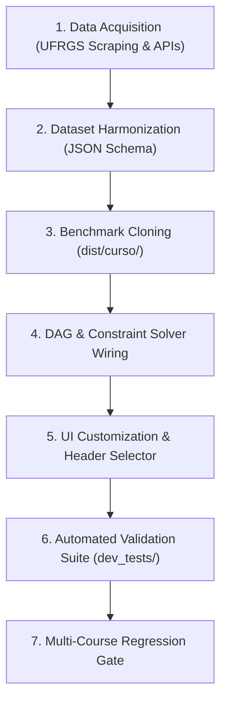

# Academic Curriculum DAG Simulator Builder (UFRGS Trajetória Acadêmica)

This skill operationalizes the complete engineering pipeline to generate, configure, and validate production-grade, 100% standalone, zero-server academic curriculum simulators for UFRGS courses.

Simulators run directly over the `file://` protocol without Node, Python, or HTTP servers, while providing a rich Miro-style infinite-canvas experience with dynamic topological DAG constraints, credit milestones, and zero-dependency Canvas 2D image/PDF exports.

---

## Architecture & Foundational Principles

### 1. Zero-Server Standalone Hygiene
Every simulator lives in its own isolated distribution folder: `dist/<curso>/`.
It must contain **strictly 5 production files** and no build artifacts, temporary dumps, or testing scripts:
```text
dist/<curso>/
├── index.html              # Clean semantic DOM with header, sidebar, and canvas board
├── styles.css              # Dark theme (#0B0F19, #161F30), Miro canvas, and pastel badges
├── app.js                  # State engine, DAG solver, drag & drop, localStorage, Canvas 2D exporter
├── curriculum_data.js      # JS fallback for zero-server file:// protocol execution
└── curriculum_data.json    # JSON master format for schema validation and programmatic imports
```

### 2. Token Economy & Boilerplate Reuse (The Ladder Rule)
**Never rewrite HTML, CSS, or the canvas engine from scratch.**
Always clone from the closest architectural benchmark in `dist/`:
- **Single-Track Curriculum (No FDC, No Shift)**: Clone from `dist/engenharia-producao/`.
- **Multi-Shift Curriculum (Diurno vs. Noturno)**: Clone from `dist/ciencias-economicas/`.
- **Elective Track Specialization (Formação Complementar / FDC)**: Clone from `dist/engenharia-controle-automacao/`.

---

## End-to-End Implementation Workflow



---

### Step 1: Ingestion & Scraping of Official UFRGS Catalogs

Acquire official curriculum structures from UFRGS systems (COMGRAD, Portal de Graduação, or FCE/Escola de Engenharia).

1. **Scraping Sources:**
   - Official undergraduate catalog URL: `https://www.ufrgs.br/site/ensino/graduacao/<curso>/`
   - UFRGS AJAX activity catalog endpoint:
     `https://www1.ufrgs.br/graduacao/informacoescadastrais/consultaDadosAtividade_Plone.php?cod=<CURRICULO>&hab=<HABILITACAO>`
2. **Schema Standardization:**
   Each course item must conform strictly to the standard schema:
   ```json
   {
     "code": "ECO02001",
     "name": "Introdução à Economia",
     "credits": 4,
     "originalSemester": 1,
     "type": "obrigatoria",
     "prereqs": [],
     "min_credits": 0,
     "periodicity": null,
     "alternativeOf": null,
     "altChoice": false
   }
   ```
3. **Field Specifications:**
   - `code`: Official alphanumeric UFRGS subject code (e.g., `MAT01109`, `ENG01001`).
   - `credits`: Number of academic credits (typically 2, 4, or 6 credits; 1 cr = 15h).
   - `originalSemester`: Recommended semester in the official pedagogical plan (`1` to `8` or `10`).
   - `type`: `"obrigatoria"` for core mandatory subjects, `"eletiva"` for elective bank subjects, or `"fdc"` for track-specific subjects.
   - `prereqs`: Array of direct prerequisite course codes (e.g. `["MAT01109", "MAT01353"]`).
   - `min_credits`: Credit barrier threshold required to enroll (e.g. `100`, `140`).
   - `periodicity`: `"/1"` if offered only in odd semesters, `"/2"` if offered only in even semesters, or `null` if offered every semester.
   - `alternativeOf` & `altChoice`: Used when students must choose between pairs (e.g., in-person vs. EAD alternatives).

---

### Step 2: Multi-Curriculum & Shift Structures

When courses have shifts (Diurno and Noturno) or multiple specializations (FDCs), structure `curriculum_data.js` and `curriculum_data.json` as a unified container:

```javascript
// Unified curriculum dictionary for multi-shift courses
const ECONOMIA_CURRICULA = {
  diurno: {
    label: "Ciências Econômicas (Diurno)",
    totalMandatoryCredits: 128,
    totalElectiveCredits: 44,
    totalCredits: 172,
    stagesCount: 8,
    courses: [ /* ... 166 courses ... */ ]
  },
  noturno: {
    label: "Ciências Econômicas (Noturno)",
    totalMandatoryCredits: 128,
    totalElectiveCredits: 44,
    totalCredits: 172,
    stagesCount: 10,
    courses: [ /* ... 166 courses ... */ ]
  }
};

if (typeof module !== 'undefined' && module.exports) {
  module.exports = { ECONOMIA_CURRICULA };
}
```

---

### Step 3: Miro-Style Infinite Canvas & Dynamic Columns

The canvas board displays drag-and-drop columns representing academic semesters:

1. **Dynamic Semester Columns:**
   - Render columns dynamically from Semester 1 up to $S_{\max}$.
   - **Dynamic $S_{\max} + 1$ Empty Buffer:** Always render at least one empty column beyond the highest occupied semester to enable smooth forward drag-and-drop.
   - **Semester 20+ Alert Styling:** Any column with index $\ge 20$ represents an extended graduation buffer. Style the column header and drop area with subtle crimson accents (`#3B1822`, border `#7F1D1D`, badge text `#FCA5A5`) to visually flag prolonged trajectories without hard limits.
2. **Original Semester Pastel Palette (10 Classes):**
   Courses carry badges indicating their official curriculum semester. Use the high-contrast 10-color pastel system:
   ```css
   /* Pastel Palette: 1st to 10th Semesters */
   .badge-sem-1  { background: #E0F2FE; color: #0369A1; } /* Pastel Sky */
   .badge-sem-2  { background: #DCFCE7; color: #15803D; } /* Pastel Emerald */
   .badge-sem-3  { background: #FEF9C3; color: #A16207; } /* Pastel Amber */
   .badge-sem-4  { background: #F3E8FF; color: #7E22CE; } /* Pastel Purple */
   .badge-sem-5  { background: #FFE4E6; color: #BE123C; } /* Pastel Rose */
   .badge-sem-6  { background: #E0E7FF; color: #4338CA; } /* Pastel Indigo */
   .badge-sem-7  { background: #FFEDD5; color: #C2410C; } /* Pastel Orange */
   .badge-sem-8  { background: #CCFBF1; color: #0F766E; } /* Pastel Teal */
   .badge-sem-9  { background: #FCE7F3; color: #BE185D; } /* Pastel Pink */
   .badge-sem-10 { background: #EDE9FE; color: #6D28D9; } /* Pastel Violet */
   ```
3. **Interactive Filter:**
   In the sidebar ("Destacar Semestre Original"), render matching clickable pastel chips (`1º Sem`, `2º Sem`, ..., `10º Sem`). When clicked, highlight corresponding cards on the canvas and dim non-matching cards. Dynamically hide 9º/10º chips if the active shift only has 8 stages.

---

### Step 4: Topological DAG Constraint Solver

The simulator enforces strict prerequisite precedence:
$$\forall A \in \text{Prereqs}(B), \quad \text{Semestre}(B) > \text{Semestre}(A)$$

```javascript
/**
 * Propagate semester movements downstream across the DAG using BFS cascade
 */
function cascadeMove(courseCode, targetSemester, visited = new Set()) {
  if (visited.has(courseCode)) return;
  visited.add(courseCode);

  const directDependents = getDirectDependents(courseCode);
  for (const depCode of directDependents) {
    const currentDepSem = state.allocations[depCode];
    if (currentDepSem !== undefined && currentDepSem <= targetSemester) {
      const nextAllowedSem = targetSemester + 1;
      state.allocations[depCode] = nextAllowedSem;
      cascadeMove(depCode, nextAllowedSem, visited);
    }
  }
}
```

1. **Parity Check (`/1` vs. `/2`):**
   - If a course has `periodicity: "/1"` and is placed in an even semester, or `periodicity: "/2"` in an odd semester, flag a visual warning badge (`⚠️ Oferta Semestral Desalinhada`) and provide one-click correction to the nearest valid parity semester.
2. **Minimum Credits Barrier (`min_credits`):**
   - When calculating status for course $B$, sum all credits allocated to strictly earlier semesters ($< \text{Semestre}(B)$).
   - If $\sum \text{Credits} < B.\text{min\_credits}$, show a barrier tag (e.g. `Requer 120 cr (acumulados: 96 cr)`).

---

### Step 5: Sidebar Counters, Shifts & Persistence

1. **Header Shift / Track Selector:**
   In `.brand-header`, render the title `Trajetória <Curso>` with `<span class="badge-ufrgs">UFRGS</span>` and a compact `<select class="shift-select">` with custom dark styling:
   ```html
   <div class="shift-selector-wrapper">
     <select id="shift-select" class="shift-select">
       <option value="diurno">☀️ Ciências Econômicas • Diurno</option>
       <option value="noturno">🌙 Ciências Econômicas • Noturno</option>
     </select>
   </div>
   ```
2. **Independent LocalStorage Isolation:**
   - Key format: `'trajetoria_<curso>_<turno>_ufrgs_v1'`
   - Active shift key: `'trajetoria_<curso>_active_shift'`
   - On shift switch: save state of current shift $\rightarrow$ update active shift $\rightarrow$ load state of new shift $\rightarrow$ re-render canvas.
3. **Dual Credit Progress Bars:**
   - Mandatory Credits Bar: tracks core required credits (e.g., 128 / 128 cr).
   - Elective Credits Bar: tracks elective credits added to the trajectory (e.g., 24 / 44 cr).
   - Total Counter: tracks complete graduation progress towards the degree target.
4. **File System Access API & Native Canvas 2D Export:**
   - **JSON Save/Load:** Use `window.showSaveFilePicker()` with fallback to `<a download>`. Always embed metadata:
     `{ "course": "<curso>", "shift": "diurno"|"noturno", "allocations": {...}, "completed": [...] }`.
   - **Canvas 2D Export:** Draw the grid, cards, pastel badges, and SVG-like bezier connection lines directly onto an offscreen HTML5 `<canvas>` scaled with `devicePixelRatio * 2`. Export as high-res PNG (`canvas.toBlob()`) and trigger native PDF vector printing via `@media print` rules without bundling heavy third-party libraries.

---

### Step 6: Automated Validation Protocol (`dev_tests/`)

Every simulator must be verified by a dedicated test script (`dev_tests/validate_<curso>.js`) and registered in `dev_tests/validate_all_projects.js`.

The test suite must verify:
1. **File Hygiene**: Strictly 5 permitted files in `dist/<curso>/`.
2. **Syntax Validation**: `node --check app.js` and `node --check curriculum_data.js` exit 0.
3. **Curriculum Completeness**: All required credit goals match official pedagogical guidelines.
4. **Referential Integrity**: 100% of codes listed in `prereqs` exist in the course catalog.
5. **DAG Acyclicity**: Kahn's topological sort confirms zero dependency cycles.
6. **Persistence Isolation**: Turn/course keys do not collide with other simulators.
7. **JSON Export/Import**: Exported payloads carry the required shift/course schema tags.

```powershell
# Run course-specific test suite
node dev_tests/validate_<curso>.js

# Run full cross-course regression test
node dev_tests/validate_all_projects.js
```

---

## Quick Reference Checklist for New Simulators

- [ ] Ingest curriculum from official UFRGS portal or AJAX API.
- [ ] Determine shift requirements (Single-track, Diurno/Noturno, or FDC specialization).
- [ ] Clone files from `dist/engenharia-producao/` or `dist/ciencias-economicas/`.
- [ ] Inject `curriculum_data.js` and `curriculum_data.json`.
- [ ] Ensure `localStorage` key names are unique and prefixed with the course name.
- [ ] Configure header titles, badges, and shift selectors.
- [ ] Verify 10-color pastel classes and filter chips.
- [ ] Write and execute `dev_tests/validate_<curso>.js`.
- [ ] Register new course in `dev_tests/validate_all_projects.js`.
- [ ] Validate zero-server `file://` execution in a browser.
